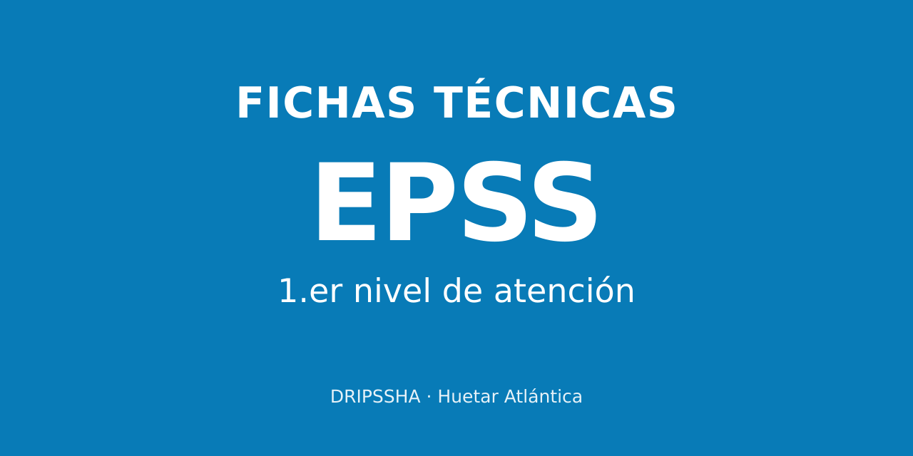

# EPSS a la mano · DRIPSSHA



Herramienta de consulta de las fichas técnicas EPSS 2024-2028 para áreas de salud. Iniciativa de la Dirección de Red Integrada de Prestación de Servicios de Salud Huetar Atlántica. No registra información de pacientes.

## Contenido

La recopilación recibida el 27 de octubre de 2026 incorpora 37 indicadores de evaluación y 47 complementarios, respaldados por 100 documentos. Los PDF se conservan sin modificaciones y se comprueban mediante SHA-256. Los indicadores agrupados en una misma ficha oficial tienen accesos separados por código.

Cada indicador comparte una fuente para Resumen y Completa. Los CIE-10 distinguen selección, exclusión y registro. Los rangos y familias no se ofrecen como un diagnóstico único para copiar. El PDF original conserva tablas y presentación; la vista Completa ofrece lectura por páginas del texto íntegro, con tipografía legible. Los campos se leen en vertical; las fracciones y las tablas se adaptan a la pantalla conservando sus relaciones. La ficha escaneada 11-02-3.0 tiene transcripción revisada visualmente.

La edición incluye versiones posteriores de HTA, DM2, anemia, Nutrición y tamizaje cervicouterino. Los criterios se incorporan directamente al indicador. Las discrepancias internas de las fuentes se identifican. En particular, 11-01-2.0 no tiene confirmada su aplicación a áreas de salud: describe hospitales II/III y simultáneamente menciona primer nivel. Se conserva acceso identificado a la referencia anterior, sin resolver la contradicción por inferencia.

El catálogo CIE-10 abre con accesos por tema. HTA y sus alias llevan a hipertensión; los códigos repetidos se agrupan conservando cada vínculo y función. Los colores suaves identifican familias en tarjetas, filtros y códigos, con el nombre siempre visible.

## Medida Resumen

MR es la primera cejilla y abre directamente la referencia verificada del III monitoreo 2025, con sus22indicadores. La composición2026 se incorporará al confirmarse; no se ofrece una vista vacía ni se calcula una nota actual.

La referencia histórica verificada corresponde al RAS del III monitoreo 2025, enero-setiembre, no al cierre anual: 21 indicadores clínicos aportan a la suma y a metas; 11-01 participa solo en metas de unidades internas. Se consideran 22 metas internas y 21 externas. Los enlaces identifican las familias históricas y abren las versiones publicadas disponibles, con una advertencia de período.

## Fuentes y créditos

La cabecera muestra solo la fecha y la hora de la última actualización de la app, en la zona America/Costa_Rica. Al publicar cambios, actualizar el texto y el atributo datetime de esa línea con la fecha y hora reales de la versión. Es un dato fijo de la versión, no un reloj del dispositivo. La sección `#cambios` conserva las modificaciones documentales de las fichas.

Las fichas oficiales corresponden a la Dirección Compra de Servicios de Salud de la CCSS. Se conserva el diseño general EPSS 2024-2028 como base documental y el informe EPSS-PNA 2025 como fuente metodológica. La fecha de recopilación no sustituye una fecha de vigencia.

La iniciativa de la herramienta y el resumen regional se acreditan a la DRIPSSHA. El resumen se muestra como antecedente de consulta, con una nota sobre las diferencias identificadas respecto de las fichas oficiales; no se destaca un área de salud. Los documentos hospitalarios exclusivos se reservan para una segunda aplicación.

## Mantenimiento

`data/curacion.json` contiene los resúmenes y metadatos documentales. `data/mr-evidencia.json` separa los períodos y roles MR. Para compilar y comprobar:

```sh
python3 scripts/build-catalog.py
python3 scripts/verify-catalog.py
node --check dist/app-v2.js
node --check dist/sw.js
```

Se requieren Python 3 y Poppler (`pdftotext`). La app publicada es estática y no necesita compilador JavaScript. Cambiar la versión de caché en `dist/sw.js` al modificar datos o fuentes.

## Estadísticas y GitHub

La propiedad GA4 **EPSS a la mano · DRIPSSHA** usa el flujo web **EPSS a la mano · primer nivel**, ID de medición `G-ZF3D4DNPKB`, con horario de Costa Rica y moneda CRC. Es independiente de las otras aplicaciones. La configuración está en `dist/assets/config.json`.

La app registra vistas de página, secciones, indicadores consultados, modo Resumen/Full y apertura de PDF. Los eventos solo usan identificadores del catálogo; no envían búsquedas escritas, datos de pacientes ni parámetros libres de la URL. La medición mejorada automática está desactivada en el flujo para evitar duplicados. Las señales de Google y la personalización publicitaria están desactivadas en la etiqueta. No se muestra un contador ficticio.

El repositorio es [9ph9jr6j75-collab/epss-a-la-mano](https://github.com/9ph9jr6j75-collab/epss-a-la-mano). El flujo `.github/workflows/github-pages.yml` comprueba el catálogo y publica `dist/` con cada actualización de `main`. Los cambios deben conservar las fuentes, compilar el catálogo cuando corresponda, pasar las comprobaciones y aumentar la versión de caché de `dist/sw.js`.

## Publicación

La identidad y el directorio están en `.openai/hosting.json`. Conservar la audiencia actual del proyecto. Los favoritos y recientes se guardan en el navegador; los PDF pueden descargarse explícitamente para uso sin conexión.

### Identidad de las familias y diabetes tipo 2

El fondo completo de cada tarjeta y de los temas CIE-10 identifica su familia con un tono suave. La navegación conserva el celeste y los complementarios mantienen borde discontinuo y rótulo propio.

E11 se presenta como «Diabetes mellitus tipo 2». Las cinco referencias E11 incluyen una aclaración con fuentes OMS: la insulinoterapia no transforma una diabetes tipo 2 en tipo 1 ni justifica, por sí sola, cambiar a E10. La denominación histórica queda explicada en segundo plano. Los PDF y su texto íntegro conservan el original.

La identidad de cada familia continúa en el interior de la ficha, en ambas versiones de consulta. La navegación general conserva el celeste. El encabezado identifica el primer nivel de atención.

La instalación tiene el botón Instalar app en el encabezado. La guía diferencia iPhone/Safari, Android/Chrome y computadora (Chrome/Edge en Windows y Safari en Mac), explica cómo salir del navegador integrado de mensajería y permite copiar el enlace. Los pasos enlazan a la documentación oficial de Apple y Google. El botón de instalación del navegador solo aparece cuando este ofrece la función.

## Observaciones y mejoras

La app permite escribir a [msolanoc@ccss.sa.cr](mailto:msolanoc@ccss.sa.cr) desde cada ficha, el pie de página y Fuentes y créditos. El enlace prepara el asunto y la referencia consultada; no envía mensajes automáticamente. Cada reporte debe revisarse antes de publicar una corrección.

Los iconos azules y la imagen de presentación están incluidos en el repositorio para conservar la identidad de la app al instalarla o compartirla.

### Lectura completa en teléfono

La versión Full organiza todos los campos como secciones que se ajustan al ancho de pantalla: definición conceptual, variables, fórmula, desagregación, metas, fuentes y comentarios. El orden lógico del PDF se comprueba contra todos los caracteres de su extracción íntegra. La ficha escaneada conserva su transcripción revisada. El texto completo y los PDF fuente permanecen sin cambios.

Las fracciones se presentan con numerador y denominador, incluidas las razones anidadas y las cinco fórmulas prenatales. Las ecuaciones aditivas conservan sus líneas. Las tablas prenatal, lipídica y de metas bucodentales se muestran por celdas, con sus columnas identificadas; las intervenciones prenatales conservan las columnas gestacionales que abarcaban las celdas combinadas. La lectura no necesita columnas de texto de ancho fijo. El PDF original sigue disponible.

`node scripts/verify-full-reader.cjs` comprueba el texto visible de las 84 fichas y las relaciones de fórmulas y tablas. `python scripts/verify-catalog.py` comprueba los documentos y los vínculos.

### PDF originales e impresión

Los enlaces a PDF internos abren un visor de la app con Volver, páginas y zoom. Al cerrarlo se conservan la ficha, el modo de lectura y su posición. PDF.js 5.6.205 se carga al solicitar un PDF; la biblioteca y el worker se conservan con sus licencias en `dist/assets/pdfjs/`. La biblioteca no se descarga al iniciar la consulta habitual.

En iPhone y iPad, el icono de impresión abre el visor. Compartir o imprimir entrega el PDF original al menú de iOS, donde se elige Imprimir o Guardar en Archivos. El archivo se prepara antes de habilitar el botón. La app evita navegar directamente al PDF en iOS. En computadora se puede abrir el archivo original en otra pestaña para imprimirlo.

Guardar documentos sin conexión incluye los componentes del visor. `node scripts/verify-document-viewer.cjs` comprueba cierre, historial, foco, cancelación de carga, límites del canvas, compartir el archivo original y caché del visor.

En posparto 01-02-2.0, los 12 CIE-10 se identifican como selección de consultas posnatales y se aclara que no deben registrarse todos juntos. El respaldo está en Fuente de información, páginas 1 y 2 del PDF oficial.
